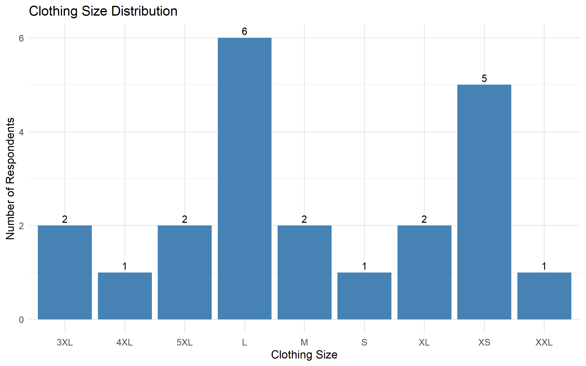
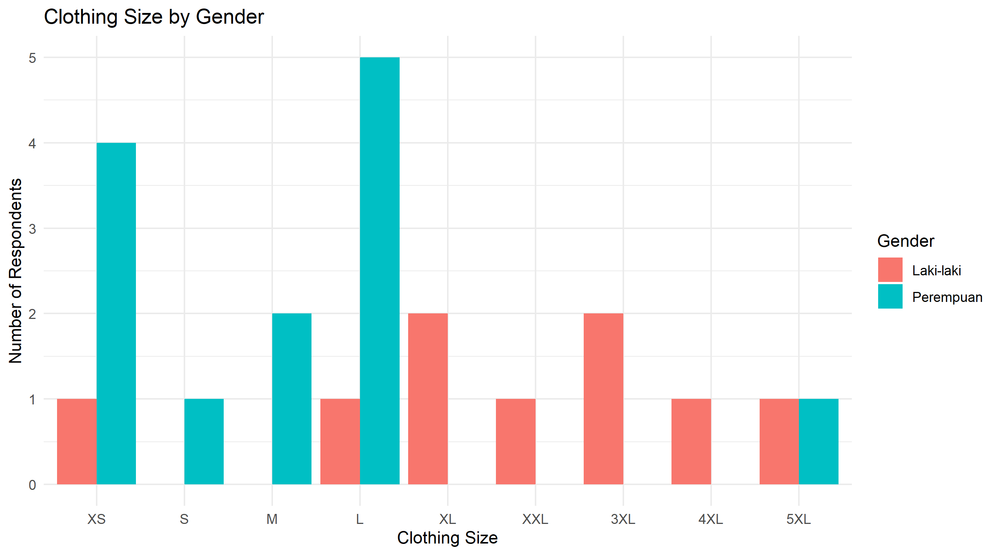
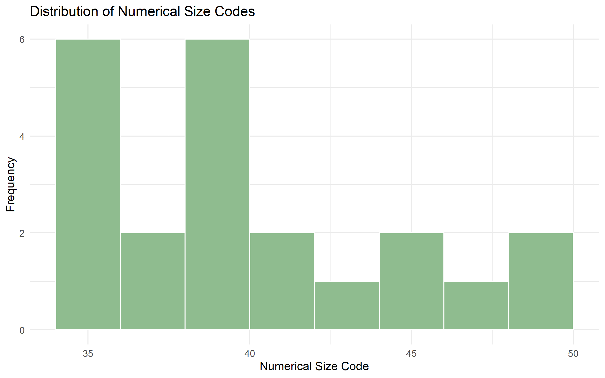
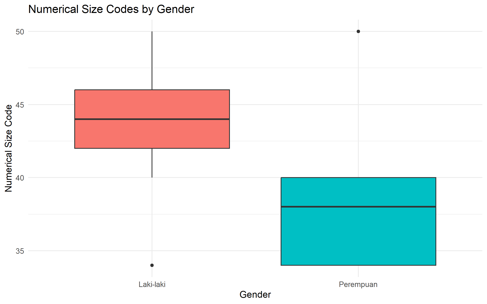

# Clothing Size Survey: Statistical Analysis with R
DATA | DATA ANALYTICS | R · RSTUDIO

Statistical analysis of clothing-size survey data collected through Google Forms, covering data cleaning, descriptive statistics, probability calculations, and visualization using R.

## 01. Project Overview

**Clothing Size Survey: Statistical Analysis with R** is a statistical data analysis project based on clothing-size survey responses collected through Google Forms. The project uses R and RStudio to explore clothing-size preferences, summarize survey data, and apply fundamental probability and statistics concepts.

### Objectives
- Apply probability and statistics concepts to real-world survey data.
- Perform data cleaning and exploratory data analysis (EDA).
- Calculate descriptive statistics and empirical probabilities.
- Analyze clothing-size distributions by gender.
- Create statistical visualizations to communicate findings.

### Problem Statement

Survey responses collected through Google Forms may contain inconsistent formatting, unnecessary columns, and categorical variables that require proper processing before statistical analysis. Without systematic analysis, it can be difficult to identify the most common clothing sizes and understand the distribution of responses.

### Solution

This project implements a reproducible statistical analysis workflow using R, from data preparation to visualization and interpretation. It generates frequency tables, descriptive statistics, empirical probability calculations, cross-tabulations, and charts to summarize the survey findings.

## 02. Tech Stack

| Technology | Purpose |
|---|---|
| R | Data processing and statistical calculations |
| RStudio | Development environment for running R scripts |
| ggplot2 | Statistical data visualization |
| Base R | Data cleaning, descriptive statistics, probability calculations, and tabulation |
| CSV | Input format for Google Forms survey data |

## 03. Screenshots / Results

### Analysis Workflow

1. **Data Import and Cleaning** — Import the Google Forms CSV file, select relevant variables, handle missing values, and prepare clothing-size categories.
2. **Dataset Overview** — Inspect the number of valid responses, variable types, and summary statistics.
3. **Frequency Distribution** — Calculate the number and percentage of respondents for each clothing-size category.
4. **Descriptive Statistics** — Calculate the mean, median, range, variance, standard deviation, quartiles, and interquartile range of numerical size codes.
5. **Probability Analysis** — Calculate empirical probabilities and conditional probabilities for clothing-size preferences.
6. **Gender Comparison** — Use cross-tabulation and percentage distributions to compare clothing-size preferences between gender groups.
7. **Data Visualization** — Generate charts to support statistical interpretation.

### Results and Visualizations

Add the generated charts to the repository after running the analysis script.

**Clothing Size Distribution**



Shows the frequency of respondents for each clothing-size category.

**Clothing Size by Gender**



Compares clothing-size frequencies between gender groups.

**Numerical Size-Code Distribution**



Displays the distribution of numerical clothing-size codes.

**Size Codes by Gender**



Compares the distribution of numerical size codes across gender groups.

### Key Findings

Based on the 22 responses in the initial dataset:

- Size **L** was the most frequently selected category, with 6 respondents (27.27%).
- There were 13 female respondents (59.09%) and 9 male respondents (40.91%).
- The empirical probability of selecting size L was 6/22, or approximately 27.27%.
- Among female respondents, 5 out of 13 selected size L, equivalent to approximately 38.46%.

These findings describe the provided responses and should not be interpreted as representative of a wider population.

## 04. Installation & Usage

### Prerequisites

- [R](https://cran.r-project.org/)
- [RStudio Desktop](https://posit.co/download/rstudio-desktop/)
- The original clothing-size survey dataset in CSV format

### Project Structure

```text
clothing-size-statistical-analysis/
├── data/
│   ├── raw/
│   │   └── clothing_size_survey.csv
│   └── processed/
├── R/
│   └── statistical_analysis.R
├── outputs/
│   ├── tables/
│   └── plots/
└── README.md
```

### Installation

**1. Clone the repository**

```bash
git clone https://github.com/YOUR_USERNAME/data-ClothingSizeAnalysis.git
cd data-ClothingSizeAnalysis
```

Replace `YOUR_USERNAME` with your GitHub username.

**2. Prepare the dataset**

Place the CSV file at:

```text
data/raw/clothing_size_survey.csv
```

Ensure the dataset contains the required columns:

- `Jenis Kelamin`
- `Ukuran Baju`
- `Kode UB`

**3. Install the required package**

Run the following command in the RStudio Console:

```r
install.packages("ggplot2")
```

**4. Run the analysis**

Open `R/statistical_analysis.R` in RStudio and execute the script from the project root directory using the **Source** button.

### Generated Outputs

After successful execution, the project generates:

- A cleaned dataset in `data/processed/`.
- Statistical tables in `outputs/tables/`.
- Visualization files in `outputs/plots/`.

### Notes and Limitations

- The analysis is based on a small survey dataset and may not represent the broader population.
- Numerical clothing-size codes are treated as coded size values; their averages and standard deviations should be interpreted cautiously.
- Personal identifiers, including respondent names and individual timestamps, should be excluded from publicly shared datasets.
- The generated charts will appear once the analysis script has been executed successfully.

---

